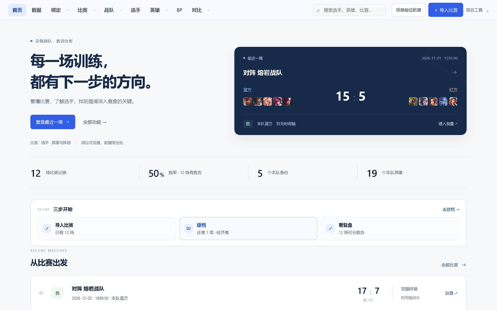
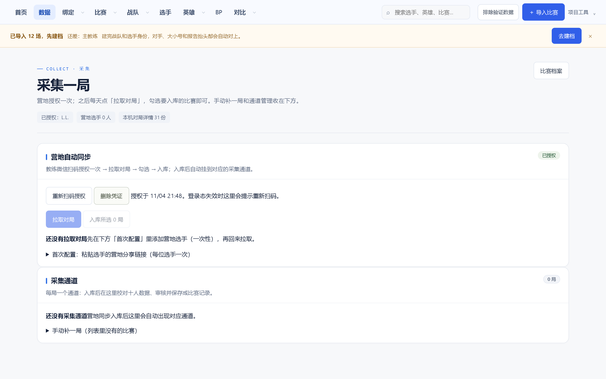
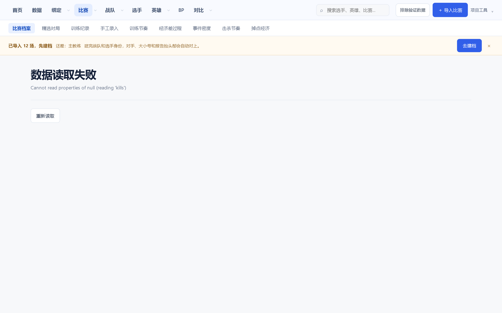
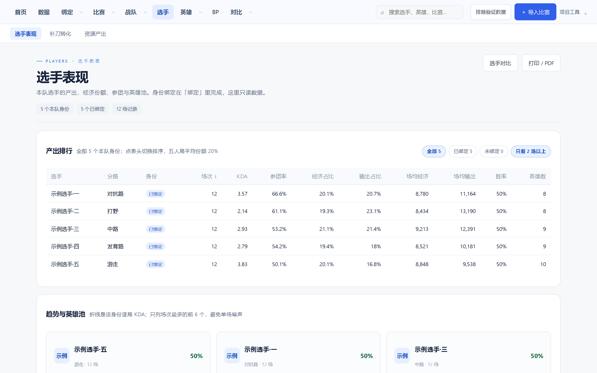
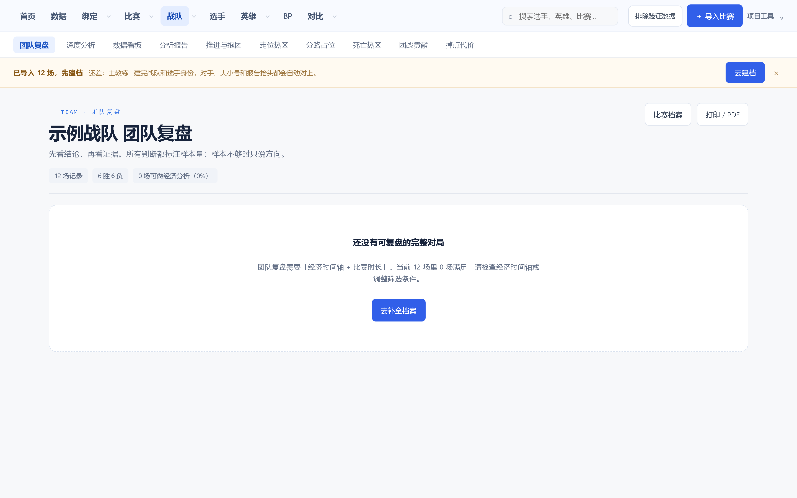
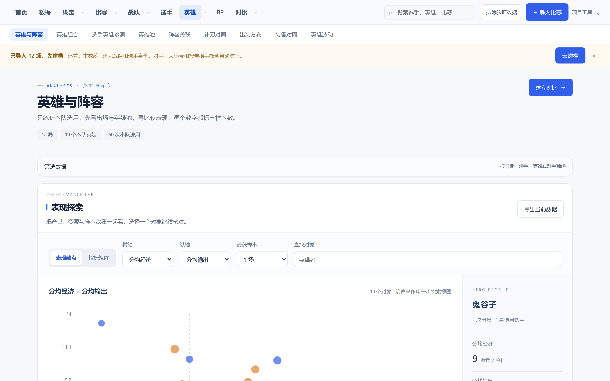
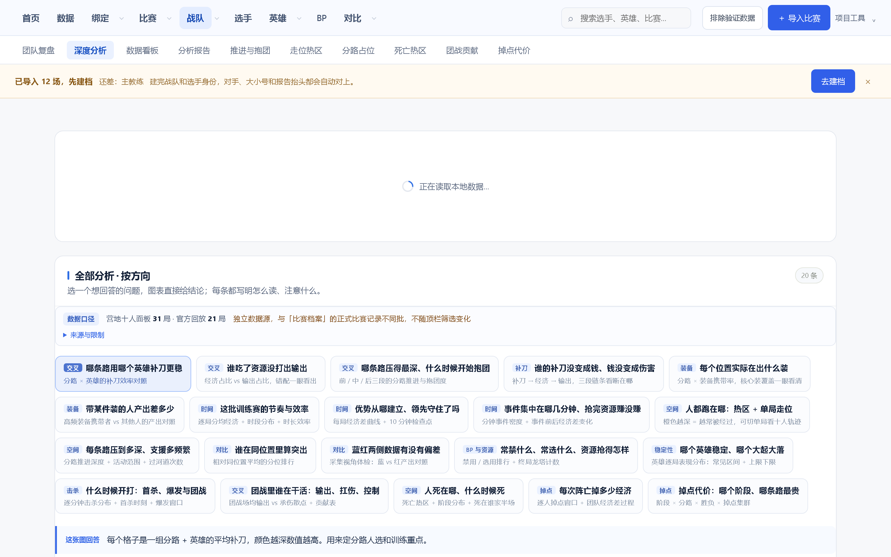
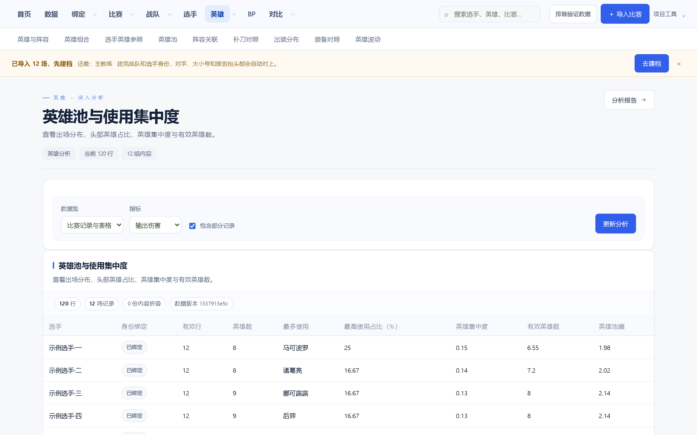

# 训练赛数据分析平台

面向 **KPL、次级联赛与各类训练赛战队** 的本机数据分析平台。

训练赛的问题从来不是「没有数据」，而是数据散在赛后截图、录屏、表格和营地链接里，
教练组要靠人工把它变成能复盘的结论。这个平台把这条链路接起来：

> **截图 / 录屏 / 表格 / 营地链接 → 本机 OCR 识别 → 人工核对入库 → 选手与团队分析**

识别在本机完成，数据全部留在本地，平台不依赖任何云端服务。



---

## 它解决什么问题

一场训练赛结束后，战队手上通常有这些东西：一张结算面板截图、一段录屏、
一份手填的表格、几个营地分享链接。要让这些变成「这局前期被压住了」「这个选手
状态在下滑」「这套阵容打不打得过对手」，中间隔着大量重复劳动：

| 现状 | 平台的做法 |
|---|---|
| 截图里的数据要一个个抄进表格 | OCR 读出面板数值，输出候选，人工确认即入库 |
| 抄错了没人发现 | 字段契约校验：缺失、类型不符、数值越界一律拦截 |
| 不同来源的数据对不上 | 通道化管理：官方 / 营地 / 表格 / 本地各自留痕，冲突显式暴露 |
| 选手认错人 | 身份绑定独立管理，身份变更需要人工确认 |
| 复盘靠记忆和 Excel | 比赛时间线、经济曲线、掉点、阵容与对手档案自动生成 |

**平台不替你下结论，它把结论需要的原始事实准备好，并且每个数字都标明来源。**

---

## 功能

### 数据采集

- **赛后截图导入** —— 识别结算面板的双列五行结构，读出每位选手的 KDA、经济、
  输出、承伤。识别结果是候选值，确认后才写入记录。
- **录屏导入** —— 逐帧抽帧后复用同一套识别流程。
- **表格导入** —— xlsx / csv 批量导入，对照字段契约校验。
- **营地链接导入** —— 分享链接解析对局详情，回放包与位置数据同步入库。
- **采集指引** —— 内置面板区域示意图，说明每类截图需要覆盖哪些字段。



### 核对与入库

- 逐项候选对照界面，OCR 候选高亮，人工确认或改写。
- 三态身份管理：未认领 / 已绑定 / 冲突。身份不会被一次误识别静默覆盖。
- 通道冲突检测：同一份截图关联到两场正式比赛会被拒绝。

### 比赛与复盘

- 比赛记录列表，按日期、对手、版本、训练分组筛选。
- 单场复盘：时间线、关键节点、掉点位置、经济曲线。
- 打印 / PDF 导出，方便写训练小结。



### 选手表现

- 分英雄、分位置的出场表现与趋势。
- KDA、经济、输出、承伤、参团率的场均值与近五局对比。
- 稳健偏差标记异常局，英雄池集中度与有效英雄数。
- 同一筛选口径下的选手 / 英雄对比。



### 团队与阵容

- 阵容构成、BP 阶段记录、版本对照。
- 对手交手档案：与不同对手的历史比分与经济差。
- 团队经济时间轴与资源记录。



### 英雄池

- 出场次数、胜率、使用选手与版本分布。
- 英雄表现横向对比，辅助判断池子深度与版本答案。



### 深度分析

- 对位分布：双人左右对位矩阵，标注推进深度与深区停留。
- 十人热区：地图热力密度场概览。
- 经济时间轴：分分钟经济差与转化率。

位置类数据标注采样口径，插值与实测不混为一谈。



### 专题研究

- 前期领先转化率、十分钟领先转化率等专题统计。
- 相关性分析、共现分析与提升度计算。
- 结果可保存为分析报告，纳入备份。



### 回放解析

- `.abc` 回放文件结构解析，记录流与帧指令解码。
- 英雄输入时间轴与指令序列提取。
- 经济、等级、KDA 检查点读取。
- 坐标类字段标注为采样或插值来源，不伪装成精确实测。

---

## 数据来源标注

平台上的每个数字都带来源标注，这套口径是数据可信度的基础：

| 标注 | 含义 |
|---|---|
| **文件解码** | 从回放或表格文件中直接解码得到 |
| **引擎实测** | 客户端运行时读取的引擎状态 |
| **UI 采样** | 从界面或小地图采样得到的位置类数据 |
| **估算** | 由已有数据推算，精度有限 |

---

## 快速开始

需要 **Python 3.11 以上**。

```bash
git clone https://github.com/hccccc01333/kpl-scrim-lab.git
cd kpl-scrim-lab

python -m venv .venv
# Windows
.venv\Scripts\activate
# macOS / Linux
source .venv/bin/activate

pip install -r requirements.txt
python server.py
```

打开 <http://127.0.0.1:8766/studio>。

首次启动会自动创建 `data/` 目录与本地数据库。Windows 用户也可以直接运行
`安装依赖.bat` 与 `启动工作台.bat`。

### 想先看看平台长什么样

```bash
python server.py                    # 另开一个终端
python scripts/seed_demo_data.py   # 灌入 12 场合成演示数据
```

演示数据全部虚构（队名、选手名、比分均为生成内容），不含任何真实对局信息。

### 可选增强

| 功能 | 安装方式 |
|---|---|
| Mimo 精读 OCR（提升数值与昵称准确率） | `pip install -r requirements-mimo.txt`，并准备模型权重 |
| 录屏抽帧 | 系统安装 `ffmpeg` |
| 前端巡检与截图 | `pip install -r requirements-dev.txt` && `playwright install chromium` |

Mimo 权重不随仓库分发。未安装或未配置时，平台自动跳过精读，只使用主 OCR 结果。

### 英雄与装备图标

仓库不包含官方游戏素材。运行一次即可把公开目录拉到本地：

```bash
python scripts/sync_catalog.py
```

不拉取也不影响使用，平台会跳过图像匹配，手工录入照常工作。

---

## 配置

复制 `.env.example` 中的变量到你的环境里即可：

| 变量 | 说明 | 默认值 |
|---|---|---|
| `TRAINING_HOST` | 监听地址 | `127.0.0.1` |
| `TRAINING_PORT` | 监听端口 | `8766` |
| `TRAINING_DB` | 本地数据库路径 | `data/training.sqlite3` |
| `ANALYSIS_MATCHES` | 比赛记录目录 | `data/matches` |
| `ANALYSIS_IMPORTS` | 导入文件目录 | `data/imports` |
| `ANALYSIS_OFFICIAL` | 官方回放缓存目录 | `data/official_replays` |
| `ANALYSIS_V2` | 回放分析目录 | `data/v2` |
| `KPL_RECORDINGS` | 录屏文件目录 | `data/recordings` |
| `TRAINING_ALLOWED_HOSTS` | 允许访问的主机名 | `127.0.0.1,localhost,::1` |
| `TRAINING_ALLOW_REMOTE` | 是否允许局域网访问 | `0` |

> 默认只监听回环地址。开启局域网访问后平台没有鉴权，请只在受信任的网络里使用。

---

## 目录结构

```
├── server.py            # 主服务与路由入口
├── version.py           # 版本号单一来源
├── analysis_*.py        # 比赛数据仓库与聚合分析
├── studio_*.py          # 工作台接口、流水线与专题研究
├── depth_api.py         # 深度分析接口
├── ocr*.py / *mimo.py   # 截图与录屏识别
├── camp_replay.py       # 营地链接与对局导入
├── channel_store.py     # 通道化数据存储
├── web/                 # 前端页面与样式（无构建步骤）
├── tools/               # 回放解析、营地客户端等运行时依赖
├── scripts/             # 导入、巡检、截图与数据种子
└── tests/               # 单元测试
```

前端是原生 ES module，仓库不带打包器。改完刷新页面即可看到效果。

---

## 参与开发

```bash
pip install -r requirements-dev.txt
python -m playwright install chromium

python -m pytest tests -q          # 单元测试
python scripts/check_deploy.py     # 部署自检
python scripts/verify_frontend.py  # 前端全站巡检
```

详见 [CONTRIBUTING.md](CONTRIBUTING.md)。

---

## 许可

本项目采用 [PolyForm Noncommercial License 1.0.0](LICENSE) 开源，
**仅限非商业用途**。个人学习、学术研究、非营利组织与教学场景可以自由使用、
修改与再分发。

**商业使用需要单独授权**——包括但不限于：俱乐部与训练机构内部采购使用、
将本项目或其衍生版本作为付费服务提供、在商业产品中集成。获取商业授权请联系
[hccccc01333](https://github.com/hccccc01333)（邮箱见 LICENSE，或
`rainfun446 at gmail dot com`），或
[提 Issue](https://github.com/hccccc01333/kpl-scrim-lab/issues) 说明使用场景。

游戏相关的英雄名称、形象与装备图片归原权利人所有，仓库不再分发这些素材，
由 `scripts/sync_catalog.py` 在本地按需获取，仅作识别参照。

## 免责声明

本项目是赛事训练分析工具，与游戏开发商及任何赛事组织方无关联，
不对数据准确性作绝对保证。请遵守游戏用户协议与所在地区的数据合规要求。
